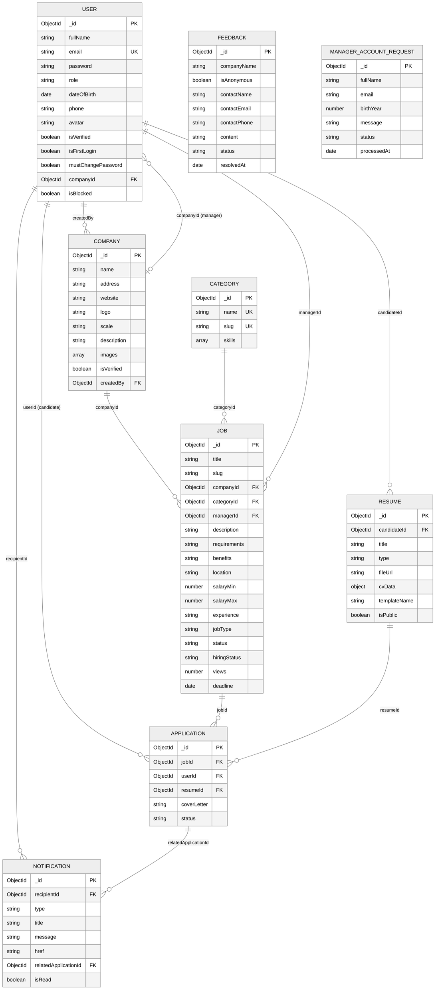
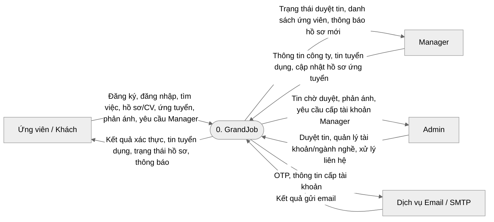
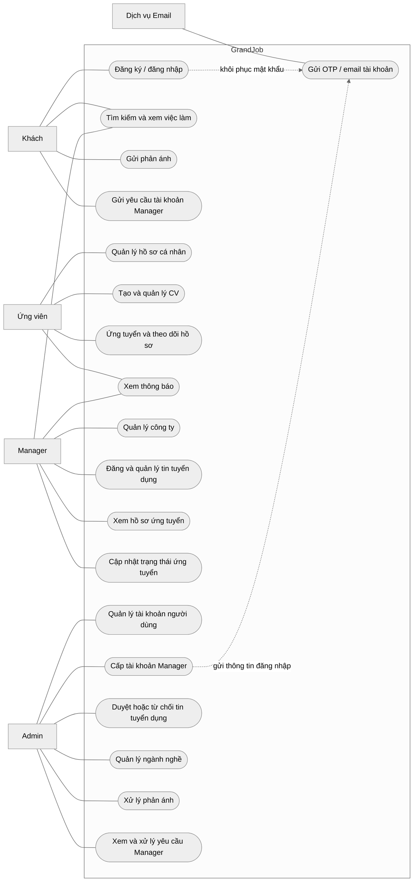
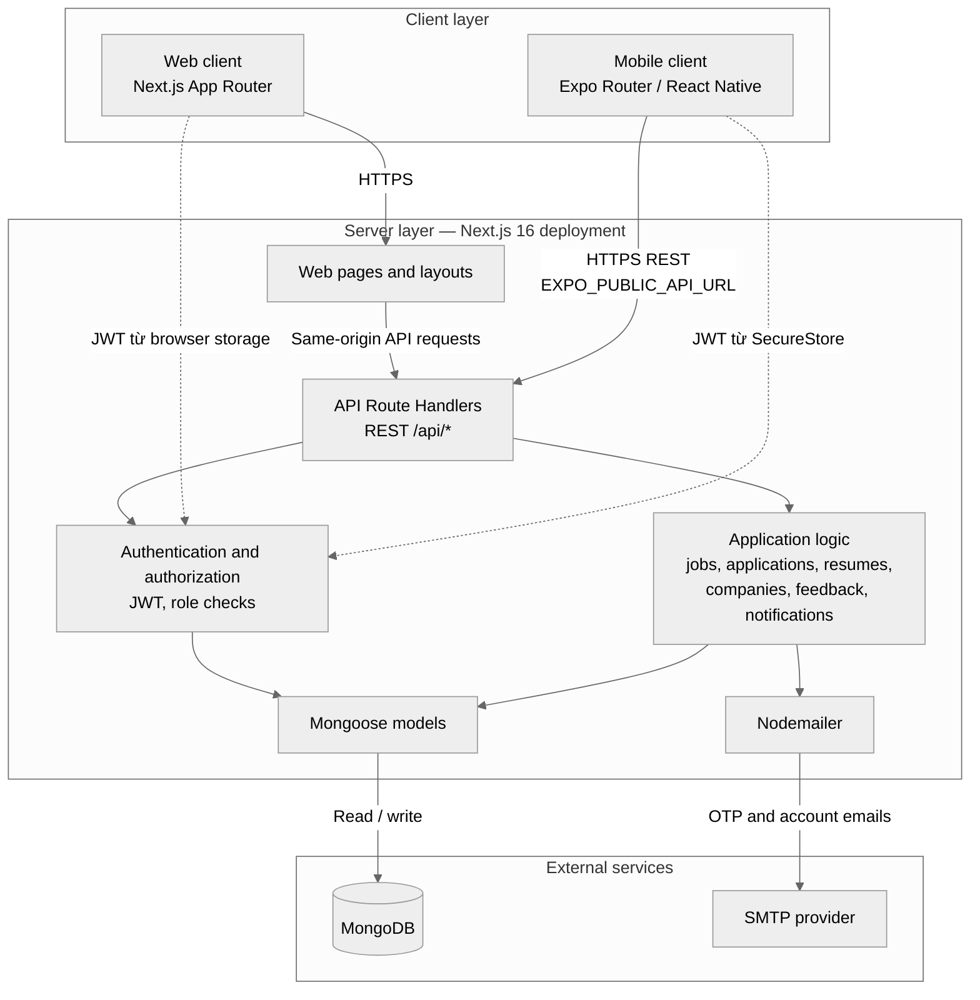
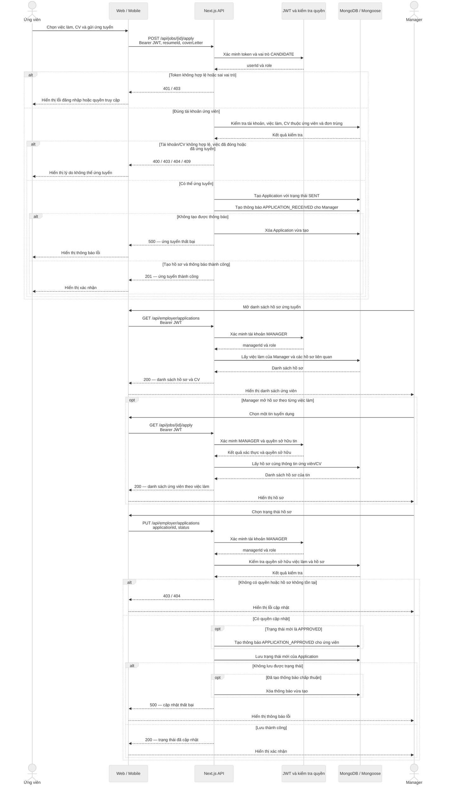
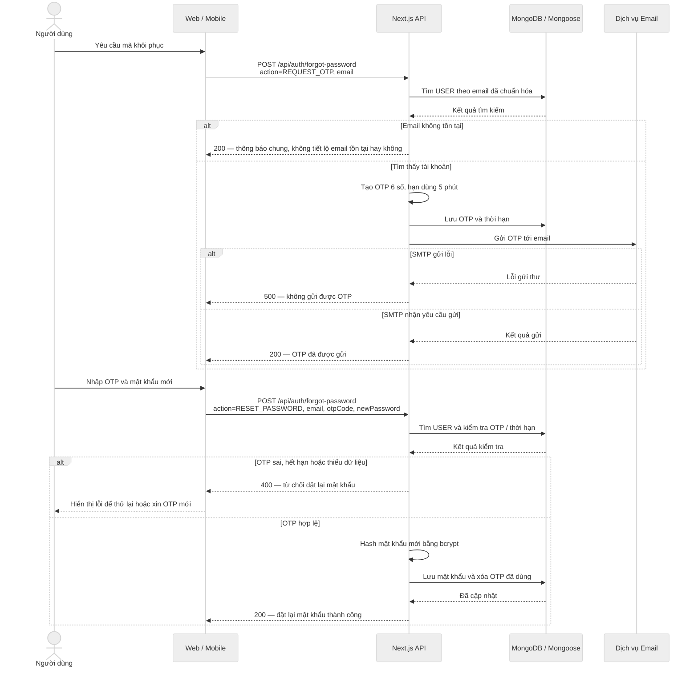
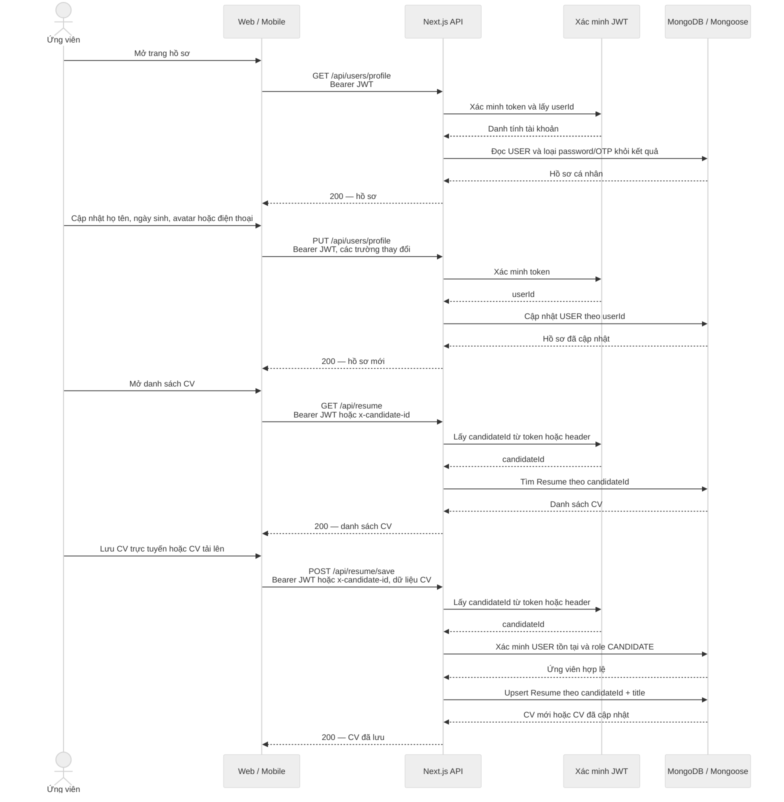
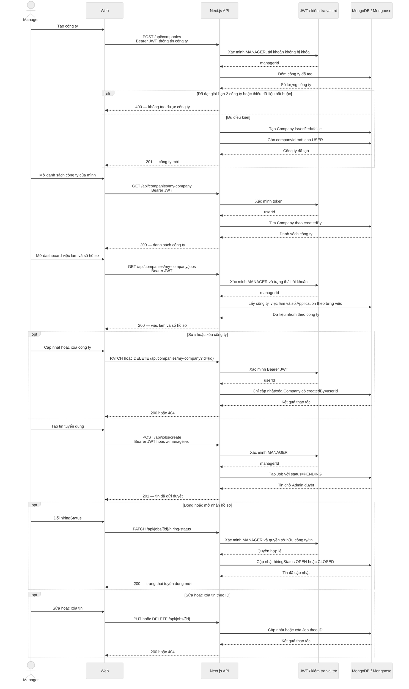
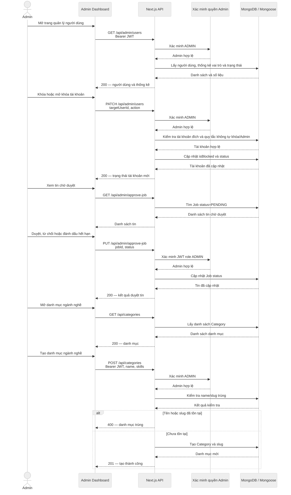
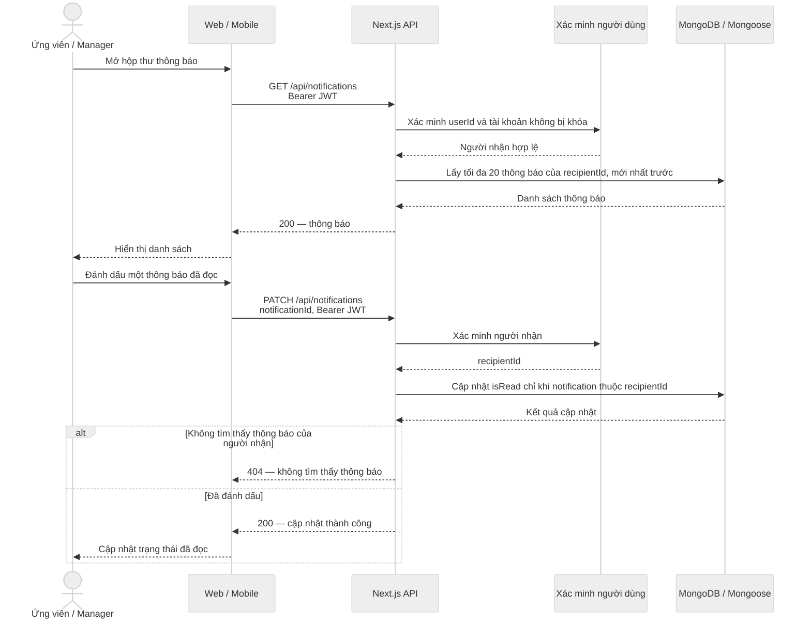

# GrandJob — System Diagrams

Tài liệu mô tả hệ thống GrandJob hiện tại: Web, Mobile, API, dữ liệu và các dịch vụ tích hợp. Các sơ đồ dùng Mermaid để có thể xem trực tiếp trên GitHub hoặc trong trình xem Markdown hỗ trợ Mermaid.

## 1. Database Diagram

Các quan hệ dưới đây được suy ra từ `ref` trong Mongoose. MongoDB không tự áp đặt foreign-key constraint như cơ sở dữ liệu quan hệ.



**Ghi chú**

- `USER.role` phân biệt `ADMIN`, `MANAGER`, `CANDIDATE`; không có collection riêng cho từng vai trò.
- `FEEDBACK.companyName` là chuỗi, không phải tham chiếu tới `COMPANY`.
- `MANAGER_ACCOUNT_REQUEST` là yêu cầu công khai trước khi Admin cấp tài khoản, nên chưa liên kết với `USER`.
- Các model có `createdAt` và `updatedAt` do Mongoose timestamps.

## 2. Data Flow Diagram — Level 0

Sơ đồ ngữ cảnh cho thấy các tác nhân bên ngoài và dữ liệu trao đổi với hệ thống. MongoDB là kho dữ liệu nội bộ, được thể hiện trong sơ đồ kiến trúc ở phần 4.



## 3. Use Case Diagram



## 4. Software Architectural Design

GrandJob hiện theo kiến trúc client-server dạng modular monolith: Web và REST API cùng nằm trong một ứng dụng Next.js; Mobile là ứng dụng Expo độc lập, gọi API của Web.



### Thành phần và trách nhiệm

| Thành phần | Trách nhiệm |
|---|---|
| Web client | Giao diện tìm việc, hồ sơ ứng viên, quản lý tuyển dụng và trang Admin. |
| Mobile client | Ứng dụng Expo dành cho ứng viên; gọi cùng API qua `EXPO_PUBLIC_API_URL`. |
| API Route Handlers | Xử lý xác thực, kiểm tra quyền, nghiệp vụ và định dạng JSON response. |
| JWT auth | Xác minh token và vai trò người dùng cho các endpoint cần đăng nhập. |
| Mongoose models | Ánh xạ các model `User`, `Company`, `Job`, `Category`, `Resume`, `Application`, `Notification`, `Feedback`, `ManagerAccountRequest`. |
| MongoDB | Lưu dữ liệu nghiệp vụ. |
| Nodemailer / SMTP | Gửi OTP khôi phục mật khẩu và email cấp tài khoản Manager. |

### Triển khai

- Web và API được deploy cùng nhau; cấu hình production đặt tại môi trường deploy.
- Mobile được build/phát hành riêng bằng Expo/EAS và cấu hình URL API trỏ về Web backend.
- MongoDB và SMTP là dịch vụ ngoài ứng dụng.

## 5. Sequence Diagram — Ứng tuyển và xử lý hồ sơ

Luồng dưới đây mô tả ứng viên nộp CV, Manager xem hồ sơ và cập nhật trạng thái. Khi hồ sơ được chấp thuận, hệ thống tạo thông báo cho ứng viên.



## 6. Sequence Diagrams cho các chức năng còn lại

Các sơ đồ dưới đây bao phủ các luồng xác thực, tìm kiếm, hồ sơ, tuyển dụng, quản trị, liên hệ và thông báo của Web và Mobile. Hai ứng dụng gọi chung các API Next.js.

### 6.1 Đăng ký, đăng nhập và đổi mật khẩu lần đầu

```mermaid
%%{init: {"theme":"neutral"}}%%
sequenceDiagram
    actor Person as Người dùng
    participant Client as Web / Mobile
    participant API as Next.js API
    participant DB as MongoDB / Mongoose

    == Đăng ký ứng viên ==
    Person->>Client: Nhập họ tên, email, ngày sinh và mật khẩu
    Client->>API: POST /api/auth/register
    API->>API: Kiểm tra dữ liệu và tuổi từ đủ 18
    API->>DB: Tìm tài khoản theo email
    DB-->>API: Kết quả kiểm tra email
    alt Thiếu dữ liệu, chưa đủ 18 tuổi hoặc email đã tồn tại
        API-->>Client: 400 — từ chối đăng ký
        Client-->>Person: Hiển thị lý do
    else Dữ liệu hợp lệ
        API->>API: Hash mật khẩu bằng bcrypt
        API->>DB: Tạo USER role CANDIDATE
        DB-->>API: Tài khoản mới
        API-->>Client: 201 — đăng ký thành công
        Client-->>Person: Hiển thị xác nhận
    end

    == Đăng nhập ==
    Person->>Client: Nhập email và mật khẩu
    Client->>API: POST /api/auth/login
    API->>DB: Tìm USER theo email
    DB-->>API: Thông tin tài khoản
    alt Không tìm thấy tài khoản
        API-->>Client: 401 — thông tin đăng nhập không đúng
    else Tìm thấy tài khoản
        API->>API: So sánh mật khẩu bằng bcrypt
        alt Mật khẩu không chính xác
            API-->>Client: 401 — thông tin đăng nhập không đúng
        else Tài khoản bị khóa
            API-->>Client: 403 — tài khoản bị khóa
        else Đăng nhập hợp lệ
            API->>API: Tạo JWT hết hạn sau 1 ngày
            API-->>Client: 200 — JWT, hồ sơ và mustChangePassword
            alt Manager cần đổi mật khẩu lần đầu
                Client-->>Person: Chuyển tới trang đổi mật khẩu
                Person->>Client: Nhập mật khẩu hiện tại và mật khẩu mới
                Client->>API: PATCH /api/users/profile<br/>currentPassword, newPassword
                API->>DB: Tải USER theo userId trong JWT
                DB-->>API: Tài khoản Manager
                API->>API: Kiểm tra mật khẩu hiện tại, hash mật khẩu mới
                API->>DB: Lưu mật khẩu và xóa cờ mustChangePassword
                DB-->>API: Đã lưu
                API-->>Client: 200 — đổi mật khẩu thành công
            else Không cần đổi mật khẩu lần đầu
                Client-->>Person: Điều hướng theo vai trò tài khoản
            end
        end
    end
```

### 6.2 Quên và đặt lại mật khẩu bằng OTP



### 6.3 Tìm kiếm và xem việc làm

```mermaid
%%{init: {"theme":"neutral"}}%%
sequenceDiagram
    actor Visitor as Khách / Ứng viên
    participant Client as Web / Mobile
    participant API as Next.js API
    participant DB as MongoDB / Mongoose

    Visitor->>Client: Mở trang việc làm
    Client->>API: GET /api/jobs
    API->>DB: Tìm Job status=APPROVED, populate Company/Category/Manager
    DB-->>API: Danh sách việc đã duyệt
    API-->>Client: 200 — danh sách công việc

    Client->>API: GET /api/categories
    API->>DB: Lấy danh sách Category
    DB-->>API: Danh mục ngành nghề
    API-->>Client: 200 — danh sách danh mục
    Client-->>Visitor: Hiển thị việc làm và tiêu chí lọc

    Visitor->>Client: Nhập từ khóa, chọn ngành nghề và nơi làm việc
    opt Tìm kiếm trên Mobile
        Visitor->>Client: Bấm nút Tìm kiếm
    end
    Client->>Client: Lọc danh sách đã tải; không gọi API tìm kiếm riêng
    Client-->>Visitor: Hiển thị các việc phù hợp

    Visitor->>Client: Chọn một việc làm
    Client->>API: GET /api/jobs/{id}
    API->>DB: Tìm Job theo ID, populate công ty/ngành nghề/Manager
    DB-->>API: Chi tiết việc làm
    alt Không tìm thấy hoặc ID không hợp lệ
        API-->>Client: 400 / 404 — lỗi tải chi tiết
        Client-->>Visitor: Hiển thị thông báo
    else Tìm thấy
        API-->>Client: 200 — thông tin việc làm
        Client-->>Visitor: Hiển thị chi tiết và lựa chọn ứng tuyển
    end
```

### 6.4 Hồ sơ cá nhân và CV



### 6.5 Quản lý công ty và tin tuyển dụng của Manager



**Lưu ý hiện trạng:** route `PUT`/`DELETE /api/jobs/{id}` hiện thao tác theo ID nhưng không tự xác minh JWT hoặc quyền sở hữu Manager; sơ đồ không thể hiện bước kiểm tra quyền cho hai thao tác này. Tạo tin và đổi trạng thái tuyển dụng có kiểm tra Manager riêng.

### 6.6 Chức năng quản trị: tài khoản, ngành nghề và duyệt tin



**Lưu ý hiện trạng:** `GET /api/admin/approve-job` hiện truy vấn tin PENDING mà không kiểm tra quyền Admin ở route; thao tác `PUT` có kiểm tra JWT role ADMIN.

### 6.7 Phản ánh, yêu cầu tài khoản Manager và cấp tài khoản

```mermaid
%%{init: {"theme":"neutral"}}%%
sequenceDiagram
    actor Visitor as Khách / Người dùng
    actor Admin
    participant Client as Web
    participant API as Next.js API
    participant Auth as Xác minh quyền Admin
    participant DB as MongoDB / Mongoose
    participant SMTP as Dịch vụ Email

    Visitor->>Client: Mở biểu mẫu liên hệ
    Client->>API: GET /api/companies
    API->>DB: Lấy danh sách công ty
    DB-->>API: Danh sách công ty
    API-->>Client: 200 — danh sách cho biểu mẫu

    alt Gửi phản ánh
        Visitor->>Client: Nhập nội dung và thông tin liên hệ hoặc chọn ẩn danh
        Client->>API: POST /api/feedback
        API->>API: Kiểm tra nội dung và thông tin liên hệ
        API->>DB: Tạo Feedback status=NEW
        DB-->>API: Phản ánh mới
        API-->>Client: 201 — đã nhận phản ánh
    else Xin tài khoản Manager
        Visitor->>Client: Nhập họ tên, email, năm sinh
        Client->>API: POST /api/manager-account-requests
        API->>API: Kiểm tra dữ liệu và đủ 18 tuổi
        API->>DB: Kiểm tra yêu cầu đang mở theo email
        DB-->>API: Kết quả kiểm tra
        alt Yêu cầu trùng hoặc thông tin không hợp lệ
            API-->>Client: 400 / 409 — không nhận yêu cầu
        else Hợp lệ
            API->>DB: Tạo ManagerAccountRequest status=NEW
            DB-->>API: Yêu cầu mới
            API-->>Client: 201 — đã nhận yêu cầu
        end
    end

    Admin->>Client: Mở trang xử lý liên hệ
    Client->>API: GET /api/feedback<br/>Bearer JWT
    API->>Auth: Xác minh ADMIN
    Auth-->>API: Admin hợp lệ
    API->>DB: Xóa Feedback RESOLVED quá 5 ngày và lấy danh sách còn hạn
    DB-->>API: Danh sách phản ánh
    API-->>Client: 200 — danh sách phản ánh

    Client->>API: GET /api/manager-account-requests<br/>Bearer JWT
    API->>Auth: Xác minh ADMIN
    Auth-->>API: Admin hợp lệ
    API->>DB: Xóa yêu cầu RESOLVED quá 5 ngày và lấy danh sách còn hạn
    DB-->>API: Danh sách yêu cầu Manager
    API-->>Client: 200 — danh sách yêu cầu

    Admin->>Client: Cập nhật trạng thái phản ánh
    Client->>API: PATCH /api/feedback<br/>feedbackId, status
    API->>Auth: Xác minh ADMIN
    Auth-->>API: Admin hợp lệ
    API->>DB: Lưu status; đặt hoặc xóa resolvedAt
    DB-->>API: Feedback đã cập nhật
    API-->>Client: 200 — trạng thái mới

    Admin->>Client: Cập nhật trạng thái yêu cầu Manager
    Client->>API: PATCH /api/manager-account-requests<br/>requestId, status
    API->>Auth: Xác minh ADMIN
    Auth-->>API: Admin hợp lệ
    API->>DB: Lưu status; đặt hoặc xóa processedAt
    DB-->>API: Yêu cầu đã cập nhật
    API-->>Client: 200 — trạng thái mới

    opt Admin quyết định cấp tài khoản Manager
        Note over Admin,API: Đây là thao tác riêng; yêu cầu không tự tạo tài khoản
        Admin->>Client: Nhập thông tin để cấp tài khoản
        Client->>API: POST /api/admin/create-manager<br/>Bearer JWT, email, họ tên, ngày sinh
        API->>Auth: Xác minh ADMIN
        Auth-->>API: Admin hợp lệ
        API->>API: Kiểm tra đủ 18 tuổi, email chưa dùng, tạo mật khẩu tạm
        API->>DB: Tạo USER role MANAGER, mustChangePassword=true
        DB-->>API: Manager mới đã được lưu
        API->>SMTP: Gửi email tài khoản và mật khẩu tạm
        alt Gửi email thất bại
            SMTP-->>API: Lỗi SMTP
            API-->>Client: 502 — tài khoản vẫn đã tạo, emailSent=false
        else Email được gửi
            SMTP-->>API: Đã nhận yêu cầu gửi
            API-->>Client: 201 — tài khoản đã tạo, emailSent=true
        end
    end
```

### 6.8 Xem và đánh dấu đã đọc thông báo



### Đối chiếu phạm vi API

| Nhóm chức năng | API được bao phủ |
|---|---|
| Tài khoản | `POST /api/auth/register`, `POST /api/auth/login`, `POST /api/auth/forgot-password`, `GET/PUT/PATCH /api/users/profile` |
| Tìm việc | `GET /api/jobs`, `GET /api/jobs/{id}`, `GET /api/categories`, `GET /api/companies` |
| Hồ sơ/CV | `GET /api/resume`, `POST /api/resume/save` |
| Công ty/việc làm Manager | `POST /api/companies`, `GET/PATCH/DELETE /api/companies/my-company`, `GET /api/companies/my-company/jobs`, `POST /api/jobs/create`, `GET/PUT/DELETE /api/jobs/{id}`, `PATCH /api/jobs/{id}/hiring-status` |
| Ứng tuyển | `POST/GET /api/jobs/{id}/apply`, `GET/PUT /api/employer/applications` |
| Quản trị | `GET/PATCH /api/admin/users`, `GET/PUT /api/admin/approve-job`, `POST /api/admin/create-manager`, `GET/POST /api/categories` |
| Liên hệ | `POST/GET/PATCH /api/feedback`, `POST/GET/PATCH /api/manager-account-requests` |
| Thông báo | `GET/PATCH /api/notifications` |
